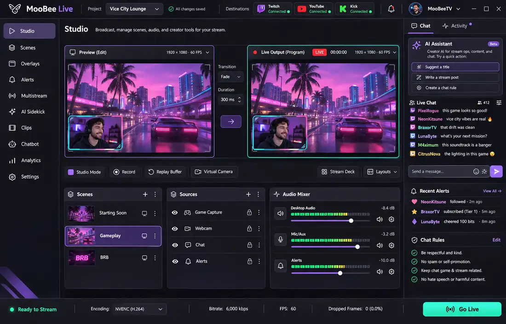

# MooBee Live

**Alpha 0.2: OBS-connected control center for desktop, Android remote control and web**

An original creator platform designed to combine OBS Studio's powerful broadcast engine with the integrated workflow of streaming dashboards. This repository is independent of and not endorsed by OBS Project or Streamlabs.



## What's included

| Area | Real implementation |
|---|---|
| OBS connection | Password-protected obs-websocket 5.x connection, local-only by default |
| Live scene control | Read scene list, switch the program scene |
| OBS Studio Mode | Separate preview/program scenes, enable Studio Mode and take a transition live |
| Scene sources | List currently selected scene items and show/hide them |
| Audio | List input devices, mute/unmute, adjust volume multiplier |
| Recording | Start and stop recording in OBS |
| Broadcasting | Start and stop streaming using OBS's configured destination |
| Program snapshot | JPEG scene screenshots updated roughly every five seconds; **not a live video feed** |
| Activity | OBS events streamed to the dashboard using Server-Sent Events |
| Alert overlay | Working browser-source page with animated follow/sub/tip/raid test alerts |
| Settings | Connect/reconnect OBS; password remains in process memory for the active session |
| Responsive UI | Desktop-first design with tablet/mobile fallbacks |
| Tauri 2 desktop shell | Native Windows/macOS/Linux app packaging configuration, custom icon, and Rust overlay service |
| Native OBS bridge | Tauri frontend connects directly to OBS WebSocket, without needing Node installed |
| Android controller | Tauri Android ARM64 test APK workflow; remote-controls OBS over a trusted private LAN (physical testing pending) |
| Web distribution | Self-hosted local Node/API archive plus static GitHub Pages preview without OBS control |

Important: Multistreaming, real platform alerts, AI Sidekick, OAuth, editor, chatbot, paid subscriptions, an embedded broadcast engine, and app marketplace are **roadmap items, not implemented features**. Tauri currently controls a separate installation of OBS Studio. See `docs/ROADMAP.md` and [research on both reference apps](docs/REFERENCE_RESEARCH.md).

### Desktop edition — Tauri 2 (recommended)

The desktop app embeds the React dashboard and connects directly to local OBS Studio through the authenticated OBS WebSocket 5.x protocol. A small Rust service serves animated alerts to OBS browser sources on `127.0.0.1:8788`. **Node.js is used for development/building, but is not a runtime dependency of the compiled desktop installer.**

See [Tauri desktop guide](docs/TAURI.md) for setup, build requirements, testing, and current limitations. On a development machine with Tauri prerequisites installed:

```bash
npm install
npm run desktop:dev
```

For a release installer, run `npm run desktop:build` or use the included GitHub Actions workflow. OBS Studio must be installed separately for alpha 0.2.

### Android and release automation

The Android target currently produces a **debug-signed ARM64 test APK**, not a store-ready release. It is a remote OBS controller, not a mobile capture/encoding engine. In **Settings**, enter your streaming PC's trusted private-LAN address (for example `ws://192.168.1.50:4455`) and OBS WebSocket password. Use OBS firewall restrictions and authentication; only use `wss://` for external network endpoints. Physical device testing remains required.

On `main`, [GitHub Actions](.github/workflows/release.yml) verifies the web/API build. A branch named `release/vX.Y.Z-alpha.N` additionally builds macOS ARM64 and Intel DMGs, a Windows NSIS setup, a Linux Debian package, the Android debug APK, and a functional self-hosted Node web archive. **Only if every job succeeds** does it publish a GitHub alpha prerelease. macOS/Windows production signing, Apple notarization, and Play Store signing are not configured yet.

The [GitHub Pages workflow](.github/workflows/web-pages.yml) publishes the **static interface preview** to `https://migtam628.github.io/moobee-stream-studio/` once GitHub Pages is enabled with **Source: GitHub Actions**. Pages cannot run this local Node OBS controller; it intentionally disables the connection button. The self-hosted archive is the functional web edition.

## Run the web companion edition

**Requirements:** Node.js 22+, npm 10+, OBS Studio 28 or newer (33.x recommended).

1. Install dependencies: `npm install`
2. Start the UI and local API: `npm run dev`
3. Open `http://127.0.0.1:5173/`
4. In OBS: **Tools → WebSocket Server Settings** → enable the server (default port 4455), enable authentication, and note the password.
5. In MooBee Live: **Settings** → enter the OBS WebSocket password → **Connect OBS**.

After connection, your OBS scenes, sources and audio inputs appear. You can switch scenes, mute inputs, record and go live using actual OBS commands. Starting a broadcast requires that you configured the destination in OBS first.

For the overlay, add an OBS **Browser Source** pointing to `http://127.0.0.1:5173/overlay/alerts` with width `1920` and height `1080`, then open **Alerts** and send a test.

### Production-like local build

```bash
npm run build
npm run start
```

Open `http://127.0.0.1:8787/`. The built dashboard, API and overlay are served from one local process.

### Optional environment configuration

Copy `.env.example` to `.env` and edit the fields. **Never commit your `.env` file.**

`OBS_WS_PASSWORD` is optional if you enter the password through the settings form. Only connect to an OBS instance you own or administer. OBS WebSocket authentication should remain enabled.

### Container option (Linux, local test)

```bash
docker compose up --build
```

The container uses host networking to reach an OBS installation on the same Linux machine and binds the API to loopback. For macOS and Windows, use the native Node startup for alpha 0.1. Containerized remote architecture is a separate milestone.

## Development verification

```bash
npm test
npm run build
npx playwright install chromium  # one-time browser download, for visual e2e tests
npm run test:e2e
```

The HTTP tests and frontend build can run without OBS installed. The visual e2e test starts a temporary local API and checks the UI, alert events and mobile overflow using Playwright. **The Tauri Rust shell has not yet been compiled in this environment because Rust and Tauri's system dependencies were unavailable.** Physical broadcast, hardware encoder, capture-card and live platform integrations must be tested on the user's own computer before being marked verified.

## Security boundary

- This alpha is for one trusted local operator. It has no user authentication or multi-tenant isolation.
- Its HTTP API can control OBS and send alert events; **do not expose port 8787 or 5173 to the public Internet**.
- The Tauri edition does not need the Node API. Its built-in overlay service listens on 127.0.0.1:8788 and only accepts browser-source viewing and local server-sent events.
- Remote OBS addresses are rejected unless `ALLOW_REMOTE_OBS=true`. Use trusted networks plus TLS when you enable remote access.
- Stream keys are not accepted or stored by this app. OBS manages the configured broadcasting destination.
- A future remotely hosted release requires encrypted OAuth tokens, secure sessions, RBAC, rate limits, monitoring, CSRF protections, and credential vaulting.

## Attribution and licensing

OBS Studio is a separate GPL-licensed project. This alpha uses OBS's documented WebSocket protocol and **does not package or redistribute OBS code**. If a future edition forks/embeds/relinks OBS, source distribution and license compliance must be reviewed before release. Streamlabs brand assets and proprietary premium templates are not included.

## Project structure

```text
apps/
  api/       Local Node.js API and OBS WebSocket bridge (web edition)
  web/       React/Vite dashboard and browser-source overlay
  desktop/   Tauri 2 + Rust native overlay service, packaging, icons
docs/
  ROADMAP.md
  TAURI.md
  design-reference.png
```
